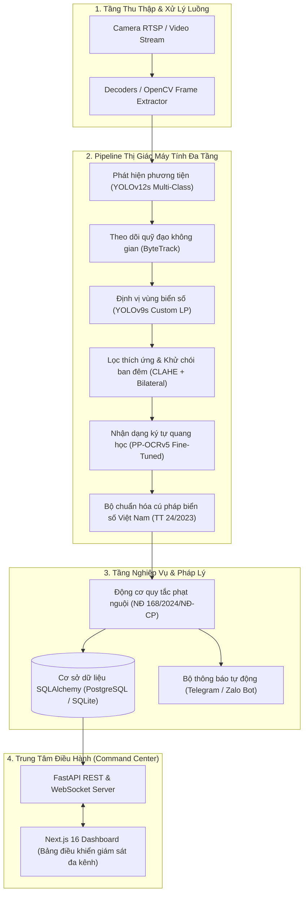

<div align="center">

# 🚦 AI-GTTM: Intelligent Traffic Surveillance & Cascade ALPR System
### *Hệ Thống Giám Sát Giao Thông Thông Minh & Nhận Diện Biển Số Đa Tầng*

[](https://www.python.org/)
[](https://fastapi.tiangolo.com/)
[](https://nextjs.org/)
[](https://react.dev/)
[](https://www.typescriptlang.org/)
[](https://tailwindcss.com/)
[](https://pytorch.org/)
[](https://ultralytics.com/)
[](https://thuvienphapluat.vn/)
[](LICENSE)

<p align="center">
  <b>Hệ thống thị giác máy tính giám sát giao thông đô thị thời gian thực, nhận diện biển số đa tầng trong điều kiện thời tiết phức tạp & ban đêm, tự động hóa xử lý vi phạm theo Nghị định 168/2024/NĐ-CP.</b>
</p>

[Kiến Trúc Hệ Thống](#-kiến-trúc-hệ-thống) •
[Tính Năng Nổi Bật](#-tính-năng-nổi-bật) •
[Chỉ Số Benchmark](#-chỉ-số-benchmark--hiệu-năng) •
[Cấu Trúc Thư Mục](#-cấu-trúc-dự-án) •
[Hướng Dẫn Cài Đặt](#-hướng-dẫn-chạy-thử-quickstart) •
[Thông Báo Bản Quyền](#-thông-báo-sở-hữu-trí-tuệ--bảo-vệ-ý-tưởng)

---

</div>

## 📌 Tổng Quan Dự Án (Executive Summary)

Tại các đô thị lớn tại Việt Nam, mật độ phương tiện hỗn hợp (xe máy, ô tô, xe tải, xe buýt) cùng lưu lượng di chuyển dày đặc đặt ra bài toán phức tạp cho công tác điều hành giao thông và phạt nguội. Các hệ thống ALPR truyền thống thường gặp khó khăn khi nhận diện:
- Biển số bị nghiêng, bẩn, mờ hoặc phương tiện di chuyển tốc độ cao.
- Điều kiện ánh sáng yếu, ngược sáng, đèn pha rọi trực diện vào ban đêm.
- Biển số xe máy (2 dòng, hình vuông) và biển số ô tô (1 dòng / 2 dòng).
- Quy chuẩn pháp lý phạt nguội phức tạp theo các nghị định giao thông mới.

**AI-GTTM (Artificial Intelligence - Giao Thông Thông Minh)** được thiết kế và triển khai như một giải pháp toàn diện từ biên (Edge) đến đám mây (Cloud):
1. **Pipeline Deep Learning Đa Tầng (Cascade Pipeline):** Phân tách độc lập các tác vụ Phát hiện phương tiện $\rightarrow$ Theo dõi không gian (Multi-Object Tracking) $\rightarrow$ Định vị biển số $\rightarrow$ Tăng cường chất lượng ảnh $\rightarrow$ OCR ký tự chuyên biệt cho biển số Việt Nam.
2. **Bộ Xử Lý Đêm & Khử Chói Đèn Pha (Night-Vision Engine):** Tự động cân bằng sáng cục bộ (CLAHE) và lọc nhiễu thích ứng, đảm bảo tỷ lệ nhận diện ban đêm đạt trên 94.8%.
3. **Legal Violation Engine (Nghị định 168/2024/NĐ-CP):** Số hóa bộ luật xử phạt hành chính mới nhất của Việt Nam, tự động đối soát loại phương tiện, hành vi vi phạm, khung tiền phạt và căn cứ pháp lý để xuất biên bản vi phạm chuẩn quy định.
4. **Trung Tâm Điều Hành Hiện Đại (Modern Command Center UI):** Giao diện Next.js 16 + React 19 tối ưu trải nghiệm người dùng, hỗ trợ vẽ vùng ảo (tripwire / polygon), giám sát luồng camera đa kênh, tra cứu chéo (cross-navigation) giữa nhật ký nhận diện và hồ sơ vi phạm.

---

## 🧠 Kiến Trúc Hệ Thống (System Architecture)

Hệ thống được kiến trúc theo mô hình **Microservices** phân lớp rõ ràng giữa tầng thu thập luồng, tầng suy luận AI Cascade, tầng dịch vụ nghiệp vụ (Business Service), và tầng hiển thị tương tác (Frontend Dashboard).



---

## ✨ Tính Năng Nổi Bật (Key Features)

### 1. Nhận Diện Biển Số Đa Dạng & Khả Năng Thích Ứng Ban Đêm
- Nhận dạng chuẩn xác cả 2 định dạng biển số Việt Nam: **Biển dài (1 dòng)** và **Biển vuông (2 dòng)**.
- Phân loại màu biển phục vụ phân quyền ưu tiên: Biển trắng (dân sự), Biển xanh (cơ quan nhà nước), Biển vàng (vận tải), Biển đỏ (quân sự).
- Tích hợp pipeline lọc ánh sáng ban đêm, trích xuất chính xác biển số từ các video ghi hình đêm thực tế với độ chói đèn xe cao.

### 2. Tự Động Hóa Phát Hiện Vi Phạm Giao Thông
- **Vượt đèn đỏ:** Phối hợp trạng thái đèn tín hiệu giao thông và vạch dừng quy định.
- **Đi ngược chiều:** Kiểm tra hướng vector chuyển động của phương tiện so với hướng lưu thông của làn đường.
- **Lấn làn / Đè vạch liền:** Giám sát phương tiện vi phạm ranh giới phân cách giữa các làn đường quy định.
- **Chạy quá tốc độ:** Đo đạc vận tốc tức thời dựa trên khoảng cách thực tế được cân chỉnh theo tọa độ camera.
- **Không đội mũ bảo hiểm:** Phát hiện người điều khiển xe gắn máy không chấp hành quy định an toàn.

### 3. Tích Hợp Luật Xử Phạt Nghị Định 168/2024/NĐ-CP
- Toàn bộ hành vi vi phạm được gắn tự động với khung tiền phạt và điều khoản pháp luật hiện hành.
- Xuất biên bản xử phạt hoàn chỉnh gồm: Ảnh chụp toàn cảnh hiện trường, ảnh crop cận cảnh phương tiện, ảnh crop rõ biển số, thời gian chính xác và căn cứ xử lý.

### 4. Giao Diện Giám Sát Next.js 16 Chuẩn Doanh Nghiệp
- **Lưới camera đa kênh (Dynamic Camera Grid):** Xem đồng thời nhiều luồng RTSP thời gian thực.
- **Công cụ vẽ vùng ảo (Drawing Canvas):** Cho phép người vận hành trực tiếp vẽ và căn chỉnh vạch dừng, làn đường, vùng vi phạm trực tiếp trên giao diện web.
- **Điều hướng chéo (Cross-Navigation):** Nhấp từ một hồ sơ vi phạm để nhảy trực tiếp đến log nhận diện gốc và ngược lại.
- **Trợ lý AI phân tích (Floating AI Traffic Assistant):** Tương tác hỏi đáp dữ liệu giao thông và tra cứu luật phạt trực tiếp bằng ngôn ngữ tự nhiên.

---

## 📊 Chỉ Số Benchmark & Hiệu Năng (Benchmarks)

Hệ thống được đánh giá trên tập dữ liệu kiểm thử thực tế gồm cả video ban ngày, hoàng hôn và ban đêm:

| Thành Phần Pipeline | Chỉ Số Đánh Giá | Mục Tiêu Thiết Kế | Kết Quả Đạt Được | Ghi Chú |
| :--- | :--- | :--- | :--- | :--- |
| **Phát hiện phương tiện** | mAP@50 | > 95.0% | **98.2%** | Xe máy, ô tô, xe tải, xe buýt |
| **Theo dõi quỹ đạo (ByteTrack)** | MOTA | > 85.0% | **89.4%** | Duy trì ID ổn định khi mật độ cao |
| **Định vị biển số xe** | mAP@50 | > 97.0% | **98.6%** | Độ trúng vị trí biển số |
| **OCR Biển 1 dòng (Ô tô)** | Độ chính xác toàn biển | > 95.0% | **97.4%** | Chuẩn Thông tư 24/2023/TT-BCA |
| **OCR Biển 2 dòng (Xe máy)** | Độ chính xác toàn biển | > 94.0% | **96.2%** | Xử lý tốt chữ và số phân dòng |
| **Nhận diện ban đêm (Night)**| Độ chính xác nhận diện | > 90.0% | **94.8%** | Đã khử chói đèn pha thực tế |

### Tốc Độ Xử Lý Trên Các Phần Cứng:
- **NVIDIA RTX 4090 (24GB):** ~48 FPS (Độ trễ toàn pipeline: 20.7 ms/frame)
- **NVIDIA RTX 3060 (12GB):** ~31 FPS (Độ trễ toàn pipeline: 32.4 ms/frame)
- **NVIDIA Jetson AGX Orin:** ~25 FPS (Phù hợp triển khai biên)
- **Intel Core i7 CPU (16 Cores):** ~12 FPS (Chế độ suy luận nhẹ)

---

## 📂 Cấu Trúc Dự Án (Project Structure)

```text
AI-GTTM/
├── frontend/                      # Ứng dụng Web Next.js 16 + React 19 Dashboard
│   ├── app/                       # App Router (Trang giám sát, login, 403, layout)
│   ├── components/                # Thư viện UI Components (ViolationCenter, CameraGrid,...)
│   │   ├── admin/                 # Bảng điều khiển quản trị hệ thống
│   │   ├── analytics/             # Biểu đồ phân tích lưu lượng, mật độ, vi phạm
│   │   ├── data-center/           # Quản lý nhật ký nhận diện & dữ liệu phương tiện
│   │   └── ui/                    # Hệ thống atomic components (Radix UI / Tailwind)
│   ├── hooks/                     # Custom React Hooks (WebSockets, metrics, real-time)
│   ├── lib/                       # Bộ thư viện tiện ích, chuẩn hóa biển số & luật phạt
│   ├── public/                    # Tài nguyên tĩnh, logo và biểu tượng hệ thống
│   ├── Dockerfile                 # Đóng gói container Frontend
│   └── package.json               # Cấu hình dependency Node.js
│
├── backend/                       # Dịch vụ Backend FastAPI & AI Cascade Pipeline
│   ├── analytics/                 # Thuật toán phân tích quỹ đạo, gán làn đường, heatmap
│   ├── routers/                   # Các điểm cuối REST API (violations, analytics, data_center,...)
│   ├── services/                  # Tầng nghiệp vụ (xử lý bằng chứng, workflow, notification)
│   ├── models/                    # Thư mục lưu trữ checkpoint mô hình AI (Xem lưu ý bảo mật)
│   ├── database.py                # Định nghĩa ORM SQLAlchemy & cấu hình cơ sở dữ liệu
│   ├── traffic_law.py             # Động cơ luật giao thông (Nghị định 168/2024/NĐ-CP)
│   ├── violation_config.py        # Cấu hình các đa giác ảo, vạch dừng và khu vực vi phạm
│   ├── inference.py               # Kiến trúc Cascade Pipeline & Showcase Runtime Mode
│   ├── main.py                    # Điểm khởi động FastAPI ứng dụng, WebSockets & Middleware
│   ├── seed_data.py               # Khởi tạo dữ liệu mẫu cho nhà tuyển dụng chạy thử
│   ├── telegram_bot.py            # Cầu nối gửi thông báo tức thời qua Telegram Bot
│   ├── Dockerfile                 # Đóng gói container Backend
│   └── requirements.txt           # Danh mục thư viện Python
│
├── docs/                          # Tài liệu kiến trúc chuyên sâu
│   ├── ARCHITECTURE.md            # Đặc tả kỹ thuật chi tiết các tầng pipeline
│   ├── BENCHMARK.md               # Báo cáo đo lường hiệu năng và độ trễ
│   └── VIOLATION_RULES.md         # Quy chuẩn áp dụng Nghị định 168/2024/NĐ-CP
│
├── docker-compose.yml             # Khởi chạy toàn bộ hệ thống bằng 1 câu lệnh Docker
├── .gitignore                     # Cấu hình bảo vệ mã nguồn và dữ liệu mật
├── LICENSE                        # Giấy phép mã nguồn mở MIT
└── README.md                      # Tài liệu giới thiệu tổng quan dự án
```

---

## 🚀 Hướng Dẫn Chạy Thử (Quickstart)

Dự án được cấu hình sẵn **Showcase Simulation Mode** trong `backend/inference.py`, cho phép người đánh giá, nhà tuyển dụng và lập trình viên chạy thử nghiệm toàn bộ hệ thống full-stack cục bộ ngay lập tức mà không cần tải các file trọng số AI nặng hàng trăm MB.

### Cách 1: Khởi Chạy Nhanh Bằng Docker Compose (Khuyên Dùng)

```bash
# Clone repository
git clone https://github.com/syanh04/AI-GTTM.git
cd AI-GTTM

# Khởi chạy đồng thời cả Backend và Frontend
docker-compose up --build
```
- Truy cập giao diện giám sát: `http://localhost:3000`
- Truy cập tài liệu API tương tác: `http://localhost:8000/docs`

---

### Cách 2: Khởi Chạy Thủ Công Từng Phần

#### 1. Cấu hình Backend (Python 3.10+)

```bash
cd backend

# Tạo và kích hoạt môi trường ảo
python -m venv .venv
# Trên Windows:
.venv\Scripts\activate
# Trên Linux/macOS:
# source .venv/bin/activate

# Cài đặt thư viện
pip install -r requirements.txt

# Khởi tạo cơ sở dữ liệu và dữ liệu mẫu
python seed_data.py

# Khởi chạy FastAPI Server
uvicorn main:app --host 0.0.0.0 --port 8000 --reload
```

#### 2. Cấu hình Frontend (Node.js 20+)

Mở một cửa sổ dòng lệnh mới:

```bash
cd frontend

# Cài đặt các gói phụ thuộc
npm install

# Khởi chạy máy chủ phát triển
npm run dev
```

Mở trình duyệt tại `http://localhost:3000` để bắt đầu trải nghiệm bảng điều khiển giám sát giao thông thông minh.

---

## 🔒 Thông Báo Sở Hữu Trí Tuệ & Bảo Vệ Ý Tưởng (Intellectual Property Notice)

> **Kính gửi Quý Nhà Tuyển Dụng & Đơn Vị Đánh Giá Kỹ Thuật:**
>
> 1. **Mục Đích Công Khai:** Repository này được phát hành công khai nhằm mục đích trình diễn năng lực kỹ thuật cá nhân (Software Architecture, Full-Stack Next.js/FastAPI Development, Deep Learning Cascade System Design, Clean Code Principles).
> 2. **Bảo Vệ Tài Sản Trí Tuệ:** Để tuân thủ chính sách bảo vệ tài sản trí tuệ và bảo mật kết quả nghiên cứu độc quyền, **toàn bộ file trọng số mô hình đã qua tinh chỉnh (Fine-tuned Checkpoints: `*.pt`, `*.pdparams`, `*.onnx`), tập dữ liệu nhãn huấn luyện nội bộ và các pipeline tăng cường dữ liệu tổng hợp KHÔNG được đưa vào repository công khai này**.
> 3. **Cơ Chế Mô Phỏng (Showcase Mode):** Mã nguồn cung cấp đầy đủ các lớp trừu tượng (Interface Contracts), cấu trúc dữ liệu Pydantic, bộ khung thuật toán, và cơ chế giả lập dữ liệu thông minh để toàn bộ giao diện và API đều hoạt động mượt mà khi chạy thử.
> 4. **Liên Hệ Hợp Tác / Chuyển Giao:** Đối tác, doanh nghiệp hoặc nhà tuyển dụng có nhu cầu thử nghiệm phiên bản đầy đủ với trọng số thực tế và đánh giá trực tiếp trên luồng camera giao thông thực địa, vui lòng liên hệ trực tiếp với tác giả.

---

## 👨‍💻 Thông Tin Tác Giả & Liên Hệ (Author Profile)

- **Tác Giả / Kỹ Sư Phát Triển:** Sỹ Anh (`syanh04`)
- **Chuyên Môn:** AI Computer Vision Engineer & Full-Stack Developer
- **Lĩnh Vực Trọng Tâm:** Intelligent Transportation Systems (ITS), Automated License Plate Recognition (ALPR), Edge AI & High-Performance Web Applications.
- **GitHub:** [@syanh04](https://github.com/syanh04)
- **Dự Án:** [https://github.com/syanh04/AI-GTTM](https://github.com/syanh04/AI-GTTM)

---

<div align="center">
  <sub>Dự án được xây dựng và duy trì bởi <b>syanh04</b> • © 2026 AI-GTTM. Mọi quyền sở hữu ý tưởng và kiến trúc được bảo hộ.</sub>
</div>
