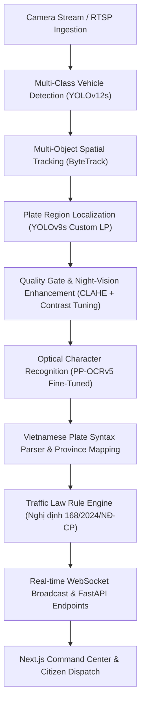

# AI-GTTM: System Architecture & Technical Specifications

## 1. High-Level Pipeline Architecture

The system implements a **multi-stage deep learning cascade** designed for high-density, heterogeneous urban traffic environments in Vietnam. By decoupling vehicle detection, tracking, license plate localization, optical character recognition (OCR), and legal violation verification into discrete modular stages, the pipeline achieves real-time inference throughput while maintaining high accuracy.

---

## 2. Pipeline Stages Deep-Dive

### Stage 1: Ingestion & Vehicle Detection
- **Input:** Video file (MP4/MKV) or RTSP live streams at 1080p / 4K resolution.
- **Model:** YOLOv12s optimized for multi-class detection (`car`, `motorcycle`, `truck`, `bus`).
- **Resolution:** 640x640 letterboxed tensor input with FP16 precision.

### Stage 2: Spatial Multi-Object Tracking
- **Algorithm:** Custom ByteTrack tracker with Kalman filter motion modeling and IoU / feature distance matching.
- **Trajectory Persistence:** Retains trajectory coordinates to compute instantaneous speeds, lane boundary crossings, and vehicle paths through virtual geometric calibration polygons.

### Stage 3: License Plate Localization
- **Input:** Vehicle bounding box crop.
- **Model:** Specialized YOLOv9s plate detector trained on over 20,000 Vietnamese vehicle license plates.
- **Output:** Bounding box coordinates and plate orientation type (1-line rectangular vs 2-line square).

### Stage 4: Adverse Weather & Night-Vision Image Enhancement
- **Preprocessing:** Adaptive Contrast-Limited Histogram Equalization (CLAHE), bilateral denoising, and gamma expansion.
- **Purpose:** Eliminates vehicle headlight glare and recovers low-light character contours during nighttime conditions (validated on real-world night traffic footage).

### Stage 5: Vietnamese Standard OCR Engine
- **Model:** Fine-tuned PP-OCRv5 text recognition backbone with custom Vietnamese character dictionary.
- **Formatting:** Resolves ambiguous characters (`8` vs `B`, `0` vs `D`, `1` vs `I`) based on Vietnamese plate syntax rules (Thông tư 24/2023/TT-BCA).

### Stage 6: Legal Violation Engine (Decree 168/2024/NĐ-CP)
- Evaluates spatial intersections against configurable polygon areas:
  - **Red Light Violations:** Vehicle crosses stop-line while signal state is `RED`.
  - **Wrong-Way Driving:** Trajectory vector opposes lane directional vector.
  - **Lane Violations:** Vehicle crosses continuous white/yellow lane markings.
  - **Speeding:** Calibrated frame-distance travel exceeds zone limit.
- Generates official citation metadata with article, clause, and administrative penalty fine range.

---

## 3. Database & Storage Architecture

- **ORM:** SQLAlchemy 2.0 with connection pooling and WAL mode for SQLite / async engine for PostgreSQL.
- **Core Entities:**
  - `detections`: Primary vehicle detection events, timestamps, plate text, speed, confidence, and image crop references.
  - `violations`: Administrative violations linked to detections, including review status (`Chờ xử lý`, `Đã duyệt`, `Đã gửi`, `Đã nộp phạt`), fine amounts, and evidence images.
  - `cameras`: Spatial camera registry with calibration polygon points, RTSP stream URLs, and hardware status.
  - `audit_logs`: Immutable security ledger recording user actions and ticket review histories.
